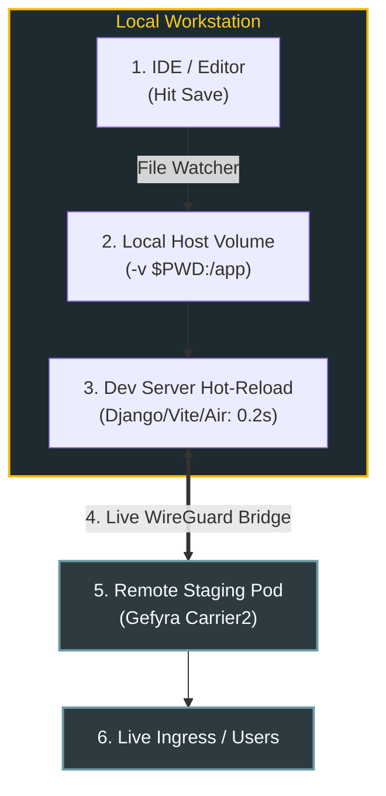

# Instant In-Cluster Hot-Reloading

The core promise of Gefyra is **collapsing the inner development loop from 20 minutes down to sub-second speeds**. 

Traditional Kubernetes development requires you to rebuild your Docker image, tag it, push it to an image registry, update a Kubernetes deployment manifest, and wait for pod rollouts on every single code change.

With Gefyra, you mount your local source code directly into your local container. Your framework's native hot-reloading engine watches for file changes on your host filesystem—and when you save, **the live remote Kubernetes cluster immediately serves the updated code**.

---

## How Hot-Reloading Works with Gefyra



1. **Volume Mount:** Your local workspace directory is mounted as a volume into the container running under Docker or Podman.
2. **File Notification:** When you save a file in VS Code, PyCharm, or any text editor, OS-level filesystem notifications trigger the container's hot-reload engine.
3. **Transparent Interception:** Gefyra routes traffic from the remote Kubernetes cluster directly to your local container port. The new code is served instantly to upstream services and ingress controllers.

---

## Language & Framework Examples

### Python: FastAPI with Uvicorn

FastAPI's `uvicorn --reload` detects file changes on disk and reloads worker processes in milliseconds.

```bash
# 1. Connect to cluster
gefyra up

# 2. Run local container with volume mount and hot-reload flag
gefyra run \
  -i my-fastapi-app:dev \
  -N local-fastapi \
  -v $(pwd)/src:/app/src \
  -c "uvicorn src.main:app --host 0.0.0.0 --port 8000 --reload" \
  -d

# 3. Mount and bridge the cluster service to your local container
gefyra mount create --target deployment/fastapi-service/api --name fastapi-mount
gefyra bridge create --mount fastapi-mount -p 8000:8000 -t local-fastapi --match-path-prefix /
```

Whenever you save a file in `./src`, Uvicorn reloads and the live cluster immediately serves your new logic.

---

### Python: Django with Runserver / Hurricane

```bash
gefyra run \
  -i my-django-app:dev \
  -N local-django \
  -v $(pwd):/workspace \
  -c "python manage.py runserver 0.0.0.0:8000" \
  -d

gefyra mount create --target deployment/django-frontend/web --name django-mount
gefyra bridge create --mount django-mount -p 8000:8000 -t local-django --match-path-prefix /
```

---

### Node.js & TypeScript: Next.js or Vite

For frontend or Node.js microservices using Vite, Next.js, or `tsx watch`:

```bash
gefyra run \
  -i node:22-alpine \
  -N local-node \
  -v $(pwd):/app \
  -c "npm run dev" \
  -d

gefyra mount create --target deployment/web-portal/portal --name portal-mount
gefyra bridge create --mount portal-mount -p 3000:3000 -t local-node --match-path-prefix /
```

Vite's Hot Module Replacement (HMR) seamlessly updates the UI while API requests from the frontend resolve through Gefyra to backend cluster services.

---

### Go: Live Reload with Air

[Air](https://github.com/air-verse/air) provides live-reloading for Go applications:

```bash
gefyra run \
  -i golang:1.24 \
  -N local-go \
  -v $(pwd):/app \
  -c "air" \
  -d

gefyra mount create --target deployment/payment-service/go-service --name payment-mount
gefyra bridge create --mount payment-mount -p 8080:8080 -t local-go --match-path-prefix /
```

When Go files change, Air recompiles the binary in under 2 seconds and restarts the listening process inside the bridged container.

---

## Troubleshooting Inotify on Linux & Docker Desktop

### Inotify Limits on Linux
If your hot-reloading server fails to pick up file changes, your host inotify watcher limit may be saturated:

```bash
# Check current limit
sysctl fs.inotify.max_user_watches

# Increase limit temporarily
sudo sysctl fs.inotify.max_user_watches=524288

# Persist permanently
echo "fs.inotify.max_user_watches=524288" | sudo tee -a /etc/sysctl.d/99-inotify.conf
sudo sysctl --system
```

### Docker Desktop for Mac File Sharing
Ensure your source repository is located within directories allowed in Docker Desktop Settings: **Settings ➔ Resources ➔ File Sharing**.
