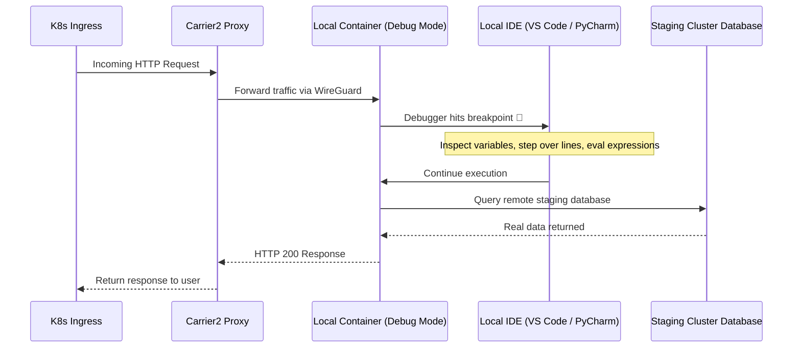

# Interactive IDE Debugging with Breakpoints

Debugging microservices in cloud environments is notoriously painful. Developers are frequently reduced to `console.log` or `print()` statements, followed by a 15-minute wait for container builds, only to dig through noisy pod logs in Datadog or Grafana Loki.

Gefyra gives you **real IDE step-through debugging against live cluster traffic**. 

When a request arrives at your cluster Ingress or from an upstream microservice, Gefyra intercepts the packet, routes it to your local container, and **hits the breakpoint in your local VS Code or PyCharm editor**.

---

## Architecture: From Ingress to Local Breakpoint



---

## Python: VS Code with debugpy

### Step 1: Run Container with debugpy Exposed

Run your container with debugpy listening on port `5678`:

```bash
gefyra run \
  -i python:3.12-slim \
  -N local-auth \
  -p 5678:5678 \
  -v $(pwd):/app \
  -c "python -m debugpy --listen 0.0.0.0:5678 --wait-for-client -m uvicorn main:app --host 0.0.0.0 --port 8000" \
  -d
```

### Step 2: Mount and Bridge Your Service

```bash
# 1. Mount the target deployment in the cluster
gefyra mount create --target deployment/auth-service/auth --name auth-mount

# 2. Bridge incoming cluster traffic to your debug container
gefyra bridge create \
  --mount auth-mount \
  -p 8000:8000 \
  -t local-auth \
  --match-path-prefix /
```

### Step 3: Configure VS Code `launch.json`

Add a remote attach configuration in `.vscode/launch.json`:

```json
{
  "version": "0.2.0",
  "configurations": [
    {
      "name": "Python: Attach to Gefyra Container",
      "type": "debugpy",
      "request": "attach",
      "connect": {
        "host": "localhost",
        "port": 5678
      },
      "pathMappings": [
        {
          "localRoot": "${workspaceFolder}",
          "remoteRoot": "/app"
        }
      ]
    }
  ]
}
```

Press **F5** in VS Code. Set a breakpoint on any controller or route handler. Send a request to your remote staging cluster ingress—your local breakpoint will pause execution immediately!

---

## Python: PyCharm / IntelliJ IDEA

1. In PyCharm, create a **Python Debug Server** run configuration.
2. Set **IDE host name:** `localhost` and **Port:** `5678`.
3. PyCharm provides a snippet:
   ```python
   import pydevd_pycharm

   pydevd_pycharm.settrace(
       "host.docker.internal", port=5678, stdoutToServer=True, stderrToServer=True
   )
   ```
4. Run your container via Gefyra, mount, and bridge:
   ```bash
   gefyra run -i myapp:dev -N myapp -v $(pwd):/app -d
   gefyra mount create --target deployment/myapp/app --name myapp-mount
   gefyra bridge create --mount myapp-mount -p 8080:8080 -t myapp --match-path-prefix /
   ```
5. As soon as the container executes the trace instruction, PyCharm attaches and unlocks full interactive debugging.

---

## Node.js & TypeScript: Chrome DevTools & VS Code

Expose Node's inspector port (`9229`):

```bash
gefyra run \
  -i node:22-alpine \
  -N local-api \
  -p 9229:9229 \
  -v $(pwd):/app \
  -c "node --inspect=0.0.0.0:9229 dist/index.js" \
  -d

gefyra mount create --target deployment/api-gateway/api --name api-mount
gefyra bridge create --mount api-mount -p 3000:3000 -t local-api --match-path-prefix /
```

Attach VS Code with this configuration:

```json
{
  "name": "Attach to Node in Gefyra",
  "type": "node",
  "request": "attach",
  "port": 9229,
  "address": "localhost",
  "localRoot": "${workspaceFolder}",
  "remoteRoot": "/app"
}
```

---

## Go: Delve (`dlv`) Debugger

For Go services, compile with debug symbols disabled from optimizations (`-gcflags="all=-N -l"`):

```bash
gefyra run \
  -i golang:1.24 \
  -N local-go \
  -p 40000:40000 \
  -v $(pwd):/app \
  -c "dlv --listen=:40000 --headless=true --api-version=2 --accept-multiclient exec ./bin/server" \
  -d

gefyra mount create --target deployment/orders-service/server --name orders-mount
gefyra bridge create --mount orders-mount -p 8080:8080 -t local-go --match-path-prefix /
```

Attach with GoLand or VS Code using the Go debugger on `localhost:40000`.
