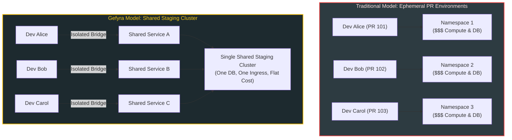

# Slashing Cloud CI/CD Compute Costs

Modern engineering organizations face a staggering financial reality: **cloud infrastructure bills for staging and CI/CD often exceed production costs**. 

The traditional push toward "ephemeral preview environments" (spinning up an entire Kubernetes namespace or cluster per pull request) creates severe cloud waste: idle compute instances, bloated container registry storage, and astronomical CI runner bills.

Gefyra provides a dramatically more cost-effective alternative: **sharing a single staging cluster safely across all developers and AI agents**.

---

## The Cost Trap: Ephemeral Environments vs. Gefyra

| Dimension | Ephemeral Per-PR Environments | Single Shared Cluster with Gefyra |
| :--- | :---: | :---: |
| **Compute Idle Cost** | **High** (Hundreds of idle staging pods) | **Zero** (Only baseline shared services run) |
| **Database Licensing / DBs** | Multiplied per pull request | Single shared staging database |
| **CI Runner Minutes** | 10–20 minutes per commit | Only runs on final PR merge |
| **Container Registry Storage** | Terabytes of un-pruned ephemeral tags | Only verified release candidates are pushed |
| **Startup / Provisioning Delay** | 10 to 25 minutes | **Instant (Under 3 seconds)** |

---

## 3 Ways Gefyra Slashes Enterprise Cloud Costs

### 1. Eliminating 70%+ of CI Runner Minutes
In traditional workflows, developers push unfinished commits just to test integration with other microservices. A team of 20 engineers pushing 5 times a day triggers **100 CI builds daily**—consuming thousands of cloud compute minutes.

With Gefyra, developers test against real staging services **locally before pushing**. CI pipelines run only when code is verified and ready for pull request review, drastically reducing runner minutes.

### 2. Eliminating Duplicate Cloud Databases
Spinning up an RDS PostgreSQL, DynamoDB, or Cloud SQL replica for every feature branch is cost-prohibitive. With Gefyra, every developer connects to the shared staging database, operating within segregated tenant schemas or utilizing ephemeral test records without paying for duplicate cloud instances.

### 3. Slashing Container Registry Egress & Storage
Every `docker push` generates multi-gigabyte image layers in Amazon ECR, Google Artifact Registry, or GitHub Packages. Storing thousands of experimental branch tags costs hundreds of dollars monthly. Gefyra keeps iteration cycles entirely on the local developer machine; only finalized, reviewed images are tagged and published to cloud registries.

---

## Financial ROI Calculator: Example 25-Engineer Team

| Cost Center | Without Gefyra (Per Month) | With Gefyra (Per Month) | Monthly Savings |
| :--- | :---: | :---: | :---: |
| **GitHub Actions / GitLab Runners** | $3,200 | $900 | **$2,300 (72% reduction)** |
| **Cloud Managed Databases (RDS/Cloud SQL)** | $4,500 (15 ephemeral DBs) | $900 (1 shared staging DB) | **$3,600 (80% reduction)** |
| **AWS EKS / GKE Worker Compute** | $6,000 | $2,200 | **$3,800 (63% reduction)** |
| **Container Registry Egress & Storage** | $1,200 | $350 | **$850 (70% reduction)** |
| **Total Monthly Infrastructure** | **$14,900** | **$4,350** | **$10,550 / month ($126,600 / yr)** |

---

## How Gefyra Ensures Safe Sharing Without Collisions

Platform teams often worry that a shared staging cluster will cause developers to step on each other's toes. Gefyra prevents this through **Namespace-Scoped Bridges and Client RBAC**:

- **Independent Bridges:** Alice can bridge the `frontend` container in the `team-checkout` namespace while Bob simultaneously bridges the `billing` container in `team-payments`.
- **Zero Cluster-Admin Needed:** Platform leads can restrict Gefyra clients via standard Kubernetes RBAC so developers can only create bridges in their designated namespaces.
- **Instant Cleanup:** When a developer stops their session (`gefyra down`), Gefyra immediately unpatches pods and restores the original cluster deployment state with zero orphaned resources.
