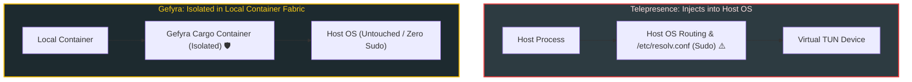

# Gefyra vs. Telepresence

When modern engineering teams seek to bridge their local machines into remote Kubernetes clusters, **Telepresence** (developed by Ambassador Labs) is one of the most widely known tools.

However, Telepresence and Gefyra are built on fundamentally different architectural philosophies. While Telepresence intercepts host OS network traffic and requires commercial cloud accounts for team features, **Gefyra is 100% open source and keeps all networking strictly isolated inside your local container runtime**.

---

## Architectural Comparison Matrix

| Dimension | Gefyra | Telepresence (v2) |
| :--- | :---: | :---: |
| **Open Source Licensing** | **100% Apache 2.0 (Zero Paywalls)** | Proprietary Core / Freemium SaaS |
| **Local Host Modification** | **None (Isolated in Docker/Podman)** | Modifies host `/etc/resolv.conf` & routing tables |
| **Local Runtime** | **Native Docker or Podman Container** | Raw host process (macOS / Linux / Windows) |
| **Root / Sudo Privileges** | **Zero Sudo (Runs Rootless with Podman)** | Requires `sudo` to alter host network stack |
| **Cluster Footprint** | **Lightweight Operator & Stowaway Gateway** | Heavy Traffic Manager Daemon + Injected Agents |
| **Team Sharing in Staging** | **Included (User-Specific Bridges)** | Paywalled (Requires Ambassador Cloud account) |
| **AI Agent Runtime Context** | **Native (Full Container & Tooling Access)** | Partial (Tied to host environment) |
| **VPN Technology** | **WireGuard (Fast, Modern, Encrypted)** | Custom TUN device & SOCKS5 proxy |

---

## Deep Dive: Core Differences

### 1. No Host Machine Pollution
- **Telepresence:** Injects a virtual TUN interface into your host operating system and dynamically modifies your host DNS configuration (`/etc/resolv.conf` on Linux/macOS) and IP routing tables. If Telepresence crashes or loses connection, your entire laptop's internet routing and corporate VPN connections can deadlock.
- **Gefyra:** Does not alter your host routing tables or `/etc/resolv.conf`. All cluster network routing, DNS overrides, and WireGuard interfaces are contained inside an isolated local Docker or Podman container (**Cargo**). Your host machine remains completely untouched.

---

### 2. 100% Open Source vs. Commercial SaaS Gatekeeping
- **Telepresence:** While basic personal interception is free, multi-developer collaboration, team preview URLs, and advanced interception features require an **Ambassador Cloud commercial account**.
- **Gefyra:** **100% Free and Open Source (Apache 2.0)**. Team scaling, namespace isolation, User-Specific Bridges, and full operator functionality are included out of the box with zero commercial licenses, tracking, or cloud account lock-in.

---

### 3. Native Docker & Podman Environments
- **Telepresence:** Runs your service as a raw process on your local laptop. If your service requires specific C-libraries, system packages, or environment configurations, you must manually install them on your host OS.
- **Gefyra:** Runs your service inside a container identical to your production image. If your workload runs in Docker, it runs flawlessly in Gefyra—even with daemonless and rootless engines like **Podman**.

---

### 4. Grounding Autonomous AI Coding Agents
- **Telepresence:** Because it operates via host networking, AI agents running in sandboxed IDEs (e.g., Cursor, Claude Code) may experience proxy leakage or struggle to bind host ports correctly when concurrent tunnels are open.
- **Gefyra:** The AI agent operates in a native containerized workspace. It can run in-cluster unit tests, curl live staging endpoints, and query cluster databases without interfering with host applications or corporate VPNs.

---

## When to Choose Gefyra

Choose Gefyra if you:
- Want a **100% open-source tool** with zero paywalled team features.
- Prefer **Docker or Podman** container workflows over running raw processes on your host.
- Work under strict corporate security policies that **prohibit sudo or host network modification**.
- Want a fast, low-friction tool that won't brick your laptop's Wi-Fi or VPN connection when disconnected.
