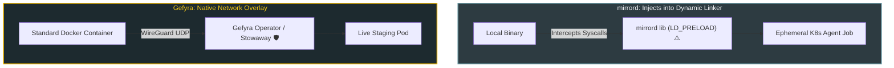

# Gefyra vs. mirrord

Both **Gefyra** and **mirrord** (developed by MetalBear) solve the inner-loop Kubernetes problem by connecting local code to remote staging clusters without requiring container builds and pushes.

However, the underlying interception mechanisms are radically different: **mirrord intercepts OS-level system calls via dynamic library injection**, while **Gefyra overlays container network traffic using WireGuard and native container engines**.

---

## Architectural Comparison Matrix

| Dimension | Gefyra | mirrord |
| :--- | :---: | :---: |
| **Interception Method** | **Network Overlay (WireGuard + Carrier2)** | System Call Hooking (`LD_PRELOAD` / `DYLD_INSERT_LIBRARIES`) |
| **Local Runtime** | **Native Docker or Podman Container** | Raw local host process or IDE plugin |
| **Language & Binary Support** | **100% Universal (Any container image)** | Limited on statically linked binaries (Go without CGO, Rust, musl) |
| **Operating System Support** | **Linux, macOS, Windows (WSL2)** | Linux, macOS (Requires disabling SIP on certain binaries) |
| **Container Parity** | **Identical to Production (Same image/env)** | Runs in local host environment with mocked syscalls |
| **Cluster Component** | **Lightweight Operator & Stowaway Gateway** | Ephemeral agent jobs spawned per debug session |
| **Traffic Direction** | **Bidirectional Intercept & Route** | Mirror (Duplicate) or Steal (Intercept) |
| **Licensing** | **100% Open Source (Apache 2.0)** | Open-Core / Commercial Cloud Control Plane (MetalBear SaaS) |

---

## Deep Dive: Core Technical Differences

### 1. Interception Mechanism: Network Overlay vs. Syscall Hooking
- **mirrord (`LD_PRELOAD`):** Injects a shared library into your local process. Whenever your application calls standard C library functions (like `socket()`, `connect()`, `open()`), mirrord intercepts the system call and forwards it to an agent pod in the cluster.
  - *Limitation:* If your binary is statically compiled (standard in **Go**, **Rust**, or Alpine **musl** libc), or if your operating system enforces strict code-signing (macOS System Integrity Protection), syscall hooking can fail or require complex compilation flags.
- **Gefyra (WireGuard & Container Overlay):** Operates at the network layer. Gefyra does not manipulate your application's binary or dynamic linker. It connects your container's network interface directly into the remote Kubernetes network fabric via an encrypted WireGuard tunnel. If it runs in a container, it runs in Gefyra—regardless of language, libc variant, or compiler settings.

---

### 2. Environment Parity (The "Works on My Machine" Problem)
- **mirrord:** Because your application runs directly on your macOS or Linux host, environment variables, local system libraries, and filesystem paths are mixed between your laptop and the remote cluster.
- **Gefyra:** Your application runs inside an authentic Docker or Podman container. Filesystem mounts, environment variables, and Linux user permissions match your production Kubernetes manifest exactly.

---

### 3. Open Source Model & Enterprise Governance
- **mirrord:** Follows an open-core model where enterprise team features (centralized RBAC management, cluster usage policies, persistent team sessions) require **MetalBear Cloud / mirrord for Teams**.
- **Gefyra:** **100% Apache 2.0 Open Source**. All operator capabilities, User-Specific Bridges, namespace isolation, and multi-developer support are freely available without commercial subscriptions.

---

## Summary: Which Tool Should You Use?

| Use Case | Best Choice | Why |
| :--- | :---: | :--- |
| **Container-Native Teams** | **Gefyra** | You develop with Docker Compose, Docker Desktop, or Podman, and want 100% production container parity. |
| **Statically Compiled Go / Rust Microservices** | **Gefyra** | Operates at the network layer and never fails due to static linking or macOS SIP restrictions. |
| **Autonomous AI Coding Agents** | **Gefyra** | AI agents need isolated container workspaces to run integration tests against real cluster endpoints. |
| **Quick Local Process Prototyping** | **mirrord** | Good for running a single lightweight Python script on your host without opening Docker. |
| **Strict Enterprise Zero-SaaS Compliance** | **Gefyra** | Completely self-contained within your cluster; zero telemetry or external SaaS dependencies. |
