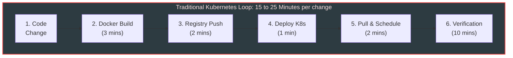
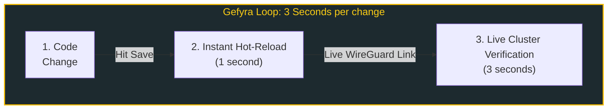

---
seo:
  title: Ship verified Kubernetes features | Gefyra — Kubernetes Local Development
  description: Eliminate slow build loops. Bridge local Docker containers and AI coding agents directly into your live Kubernetes cluster in seconds. 100% open source.
---

::u-page-hero
---
class: "gefyra-stage"
links:
  - label: Read the 2-Minute Quickstart
    to: /en/quickstart
    color: primary
    size: xl
    trailing-icon: i-lucide-arrow-right
  - label: Connect your AI Coding Agent
    to: /en/ai-agents/cluster-ground-truth
    color: neutral
    size: xl
    trailing-icon: i-lucide-bot
---
#headline
:icon{name="i-gefyra-logo-vertical" mode="svg" class="home-icon"}

#title
Ship verified Kubernetes features. No image builds. No CI waiting loops.

#description
Gefyra bridges your local machine into your remote Kubernetes cluster. Run your code and local AI agents natively in your staging environment with instant hot-reloading.

#default
  :::card-group
    ::::card
    ---
    title: Supercharge Local AI Coding Agents
    ---
    **Give Local AI the Missing 50%: Live Cluster Ground Truth.**  
    Why mock your cluster when your agent can query it directly? Run Cursor, Claude Code, or Gemini CLI against staging databases, identity providers, and internal APIs. Let your agent test and fix code with real feedback, zero hallucinations, and zero remote deployments.
    ::::

    ::::card
    ---
    title: Blazingly Fast Inner Loop (Code ➔ Test in Seconds)
    ---
    **From 20 minutes to 3 seconds.**  
    Traditional microservice debugging takes 10+ minutes per code change across container registries and cluster rollouts. Gefyra brings execution down to standard local speeds with native breakpoints, IDE debuggers, and hot-reload engines.
    ::::
  :::
::

::u-page-section
---
class: "border-t"
---
#title
Why Gefyra?

#description
A non-invasive, open-source approach engineered for secure enterprise environments and agile teams.

#features
  :::u-page-feature
  ---
  icon: i-lucide-zap
  ---
  #title
  Supercharge Development Speed

  #description
  Zero-Build Live Development. Gefyra temporarily intercepts cluster pods and transparently routes the traffic to your local container runtime. This cuts down feedback loops by 90% and allows engineers to spot and fix environment bugs in seconds.
  :::

  :::u-page-feature
  ---
  icon: i-lucide-container
  ---
  #title
  Native Podman & Docker Support

  #description
  Daemonless Container Engine Compatibility. Gefyra runs flawlessly on Docker Desktop, Rancher Desktop, and native **Podman** environments. It seamlessly aligns with strict corporate security policies by allowing developers to work rootless under Linux.
  :::

  :::u-page-feature
  ---
  icon: i-lucide-users
  ---
  #title
  Shared Staging Clusters at Enterprise Scale

  #description
  User Specific Bridges. Gefyra’s operator architecture isolates network bridges per individual developer. No matter how large your engineering team is or grows, **every single developer can safely test and debug inside the exact same shared staging cluster simultaneously** — each working securely within their own assigned namespace, with zero traffic collisions.
  :::

  :::u-page-feature
  ---
  icon: i-lucide-shield-check
  ---
  #title
  Secure Namespace & RBAC Isolation

  #description
  Granular Kubernetes Enclosure. Gefyra restricts all local connections tightly within the developer's pre-assigned Kubernetes namespaces. Platform teams can confidently greenlight the tool because it fully respects existing RBAC policies without requiring global cluster-admin rights.
  :::

  :::u-page-feature
  ---
  icon: i-lucide-bug
  ---
  #title
  Fight Environment Bugs

  #description
  Shared Kubernetes-based Resources. Your local code execution interacts natively with internal cluster databases, private APIs, and cloud microservices. This eliminates the need for fragile local mocks and guarantees testing under real production-like dependencies from day one.
  :::

  :::u-page-feature
  ---
  icon: i-lucide-laptop
  ---
  #title
  Flexible Workflows
  #description
  Direct IDE & Debugger Integration. Connect live remote cluster traffic seamlessly to local breakpoints in VS Code, IntelliJ, or PyCharm. Developers can diagnose heavy cloud bugs using the powerful, familiar desktop tools they love instead of digging through chaotic log files.
  :::

#footer
:gefyra-marquee
::

::u-page-section
---
class: "border-t"
---
#title
Start Here

#description
From first install to production settings — three short stops through the docs.

#default
:docs-path
::

::u-page-section
---
class: "border-t inner-loop-section"
---
#title
The Inner-Loop Velocity Gap

#description
See the difference between the traditional development loop and Gefyra.

#default

::

:gefyra-use-cases

::u-page-section
---
class: "border-t"
---
#title
How it works

#description
Gefyra acts as a lightweight user-space application and requires **zero permanent modifications** to your production Kubernetes manifests.

  :::u-stepper
  ---
  defaultValue: 2
  disabled: true
  size: lg
  items:
    - title: gefyra up
      description: Prepares your local engine environment and establishes an encrypted WireGuard tunnel directly to your target cluster.
    - title: gefyra run
      description: Starts your local Docker/Podman container directly inside the cluster network with internal DNS and database access.
    - title: gefyra mount & bridge create
      description: Mounts the cluster workload and routes live ingress/HTTP traffic into your local container based on path or header rules.
    - title: gefyra down
      description: Clean exit. Removes active bridges, unmounts workloads, and restores original cluster state with zero leftover footprints.
  ---
  :::
::

::u-page-section
---
class: "border-t"
---
#title
The Blueshoe Cloud & Kubernetes Ecosystem

#description
Building and scaling cloud-native workloads? Discover other developer tools and consulting services created by the team at [Blueshoe](https://www.blueshoe.io){target="_blank" rel="noopener noreferrer"}:

#default
:::ecosystem-cards
  ::::ecosystem-card
  ---
  title: Django Hurricane
  tag: Django App
  logo: /img/ecosystem/hurricane.png
  url: https://django-hurricane.io
  linkText: Explore Hurricane →
  ---
  **The Kubernetes-native application server for Django.** Achieve 2x throughput, eliminate 404 scanning attacks, and synchronize database migrations directly with Kubernetes startup and readiness probes.
  ::::

  ::::ecosystem-card
  ---
  title: pytest-kubernetes
  tag: Testing & CI
  logo: /img/ecosystem/pytest-kubernetes.svg
  url: https://github.com/Blueshoe/pytest-kubernetes
  linkText: View on GitHub →
  ---
  **Stop mocking Kubernetes. Test against the real thing.** A lightweight pytest plugin that orchestrates authentic local clusters (k3d, kind, minikube) with a single fixture—applying manifests, port-forwarding, and cleaning up automatically.
  ::::

  ::::ecosystem-card
  ---
  title: Kennel
  tag: Container Security
  logo: /img/ecosystem/kennel.webp
  url: https://kennel.blueshoe.io
  linkText: Explore Kennel →
  ---
  **Guard your containers. Instant clarity in one click.** On-demand container image security platform providing SBOM generation, OSV vulnerability scans, layer reconstruction, and end-of-life checks with zero pipeline setup.
  ::::

  ::::ecosystem-card
  ---
  title: Blueshoe Cloud Consulting
  tag: Architecture & Services
  logo: /img/ecosystem/blueshoe.svg
  url: https://www.blueshoe.io
  linkText: Cloud Native Services →
  ---
  **Enterprise Kubernetes Architecture & Platform Modernization.** Partner with the creators of Gefyra and Hurricane. We help teams architect, migrate, and scale mission-critical cloud-native platforms with zero downtime.
  ::::
:::
::

::u-page-section
---
class: "border-t"
---
#title
Community & Support

#description
Have questions, architectural ideas, or need help optimizing your deployment? Join the community:

#default
- Chat with the team on [Discord](https://discord.gg/8NTPMVPaKy){target="_blank" rel="noopener noreferrer"}
- Follow and connect on [LinkedIn](https://www.linkedin.com/company/blueshoe/){target="_blank" rel="noopener noreferrer"}
- Star the project and contribute on [GitHub](https://github.com/gefyrahq/gefyra){target="_blank" rel="noopener noreferrer"}
::
